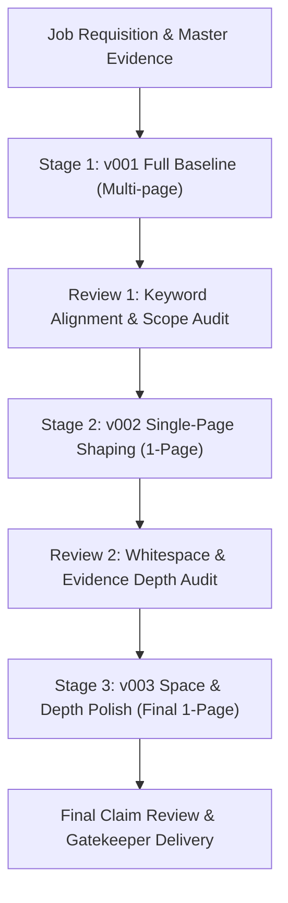

# DoorKnock 3-Stage Resume Review & Refinement Skill (履歷三段打磨工藝)

Use this skill only when the user explicitly requests the full three-stage review/refinement pipeline. For ordinary resume creation, tailoring, or a focused review/revision, follow `doorknock-tailor`; its review method may be borrowed without executing all three stages. Do not automatically publish v001 → v002 → v003 or create intermediate versions. The pipeline is opt-in, not the default for every resume.

---

## Core Strategic Principles (排兵布陣心法)

1. **Clear chronology, relevant substance**:
   - Default to reverse chronological order by end date in Experience, with ongoing roles first. Preserve exact dates and distinguish employers, roles and concurrent work; do not mix relevance-ranked and chronological entries in one unlabelled section.
   - Emphasize the strongest verified, role-relevant work in the Summary and through bullet selection and depth within each role, rather than moving an older employer above a newer one. A clearly labelled alternative grouping can be used when the user approves it.

2. **Preserve continuity without dilution**:
   - Retain or omit a contract role based on its relevance and the work-history selection rule; if retained in a chronological section, place it according to its actual dates, including ongoing work at the top.
   - Keep less relevant roles concise and give stronger examples more detail, without implying that a `Present` entry eliminates concerns about employment gaps.

3. **Selective Omission Policy (次要經歷選材規範)**:
   - Apply the tailor skill's work-history selection rule, including any candidate-authorized omission of less relevant roles. Assess transferable evidence as well as direct domain overlap; do not automatically omit a role just because its industry differs.
   - Consider chronology, career continuity and potential gaps, and honor explicit role-specific inclusion choices. Selection only affects the tailored resume, not master evidence.

4. **Remote vs. Local Geotagging (遠距去地域化)**:
   - For remote job requisitions, eliminate local geographic qualifiers from the Summary (e.g. remove local city/region phrases), framing the candidate purely on functional mastery and time-zone flexibility.

5. **No Artificial Visual Padding (反視覺灌水)**:
   - **Strictly forbid** enlarging body text, inflating line spacing, or bloating fonts to fill bottom whitespace.
   - Typst layout rules clamp standard executive typography (Times New Roman, base 10.5pt, minimum 9.3pt).
   - If whitespace exists, fill it with **substantive verified depth** from `master_evidence.yaml` (concrete methods, defensive checks, error recovery, and quantitative metrics).

6. **Strict Truth Anchor & Number Binding (事實定錨與數據綁定)**:
   - Ground truth is strictly anchored on `workspace/master_resume/master_evidence.yaml` and `workspace/profile.yaml`.
   - Every number in the resume must be explicitly tracked and bound via `claim_evidence` pointing to the exact bullet ID in `master_evidence.yaml`.

---

## The 3-Stage Review & Refinement Pipeline



### Stage 1: Round 1 (v001 基線 — Full Evidence & Keyword Alignment Baseline)

* **Goal**: Establish the complete, unconstrained baseline containing all relevant verified evidence without artificial truncation.
* **Configuration**: `require_single_page = False`.
* **Process**:
  1. Read the target posting and extract 4–6 verbatim requirement quotes.
  2. Map quotes to verified evidence IDs in `master_evidence.yaml` creating the `keyword_alignment` table (`direct`, `transferable`, or `unsupported` gaps).
  3. Include full relevant work history across available commercial and technical experiences and top projects.
  4. Author `authored_[slug]_v001.json` with `tailor_strategy`, `keyword_alignment`, `claim_review`, and `resume`.
  5. Compile via DoorKnock CLI:
     ```powershell
     uv run python backend/app/tailor/cli.py --job-id <JOB_ID> --document-type resume --authored-json <AUTHORED_V001_JSON>
     ```
  6. Output: `v001` PDF (typically 2 pages), serving as the unconstrained reference baseline.

---

### Stage 2: Round 2 (v002 單頁塑形 — Single-Page Shaping & De-AI Condensation)

* **Goal**: Shape and compress the resume into a strict, punchy 1-page executive deliverable.
* **Configuration**: `require_single_page = True`.
* **Process**:
  1. **Experience Selection**: Apply the tailor skill's work-history selection rule. Retain role-relevant evidence and use reverse chronological order unless the user approves a clearly labelled alternative; emphasize stronger work through bullet selection and depth, not an unexplained reorder.
  2. **Project Selection**: Retain the single most relevant technical/analytical project matching the job's core technical challenge.
  3. **Sepia De-AI Condensation**: Apply active verb phrasing, eliminate hollow adverbs and filler. Ensure bullets emphasize friction solved, constraints, and methods used.
  4. **Claim Evidence Update**: Update JSON pointers in `claim_evidence` to match the pruned bullet positions.
  5. Author `authored_[slug]_v002.json` and compile via DoorKnock CLI:
     ```powershell
     uv run python backend/app/tailor/cli.py --job-id <JOB_ID> --document-type resume --authored-json <AUTHORED_V002_JSON>
     ```
  6. Verify page count is exactly 1:
     ```powershell
     uv run python -c "from pypdf import PdfReader; reader = PdfReader('<PDF_PATH>'); assert len(reader.pages) == 1, 'Page count overflow!'"
     ```

---

### Stage 3: Round 3 (v003 留白深化與定稿 — Space & Depth Polish with Claim Review)

* **Goal**: Audit vertical whitespace and enrich bullet depth using verified facts from `master_evidence.yaml` for a dense, visually authoritative presentation.
* **Configuration**: `require_single_page = True`.
* **Process**:
  1. **Whitespace Inspection**: Inspect the bottom margin of the `v002` PDF.
  2. **Substantive Enrichment**:
     - If vertical room permits 1–2 more lines, do NOT inflate font sizes.
     - Extract verified secondary accomplishments from `master_evidence.yaml`:
       * E.g. Add verified month-end reconciliation reporting to leadership.
       * E.g. Add holdout capacity evaluation, precision, and lift metrics from project evidence.
       * E.g. Add executive reporting and progress presentation bullets.
     - Update `claim_evidence` to bind new numeric metrics to their exact evidence IDs.
  3. **Full Claim Review**: Validate with `validate_resume_evidence` and ensure `claim_review.status = "ready"` with zero findings.
  4. Author `authored_[slug]_v003.json` and compile via DoorKnock CLI:
     ```powershell
     uv run python backend/app/tailor/cli.py --job-id <JOB_ID> --document-type resume --authored-json <AUTHORED_V003_JSON>
     ```
  5. **Verification Gate**:
     - Confirm page count == 1.
     - Confirm selectable text characters (>3,500 chars).
     - Confirm typography scale intact (Times New Roman, no degraded fonts).
  6. Output: `v003` PDF (Final Deliverable).

---

## Quick Reference CLI Invocations

```powershell
# 1. Compile Authored JSON to Target Version
# Run from the DoorKnock repository root.
uv run python backend/app/tailor/cli.py --job-id <JOB_ID> --document-type resume --authored-json <JSON_PATH>

# 2. Verify Page Count
uv run python -c "from pypdf import PdfReader; print('Pages:', len(PdfReader('<PDF_PATH>').pages))"

# 3. Check DoorKnock Version Status
uv run python -c "import sys; sys.path.insert(0, 'backend'); from app import documents; print(documents.get_job_documents_info('<JOB_ID>'))"
```

---

## Output Structure

All versions are preserved under DoorKnock's immutable application workspace:
```
workspace/applications/YYYY-MM-DD-[company]-[role]-[slug]/
├── resume/
│   ├── v001/
│   │   ├── [Candidate_Name]_Resume_[Company].pdf (Baseline 2-page)
│   │   ├── keyword-review.json
│   │   └── workspace-metadata.json
│   ├── v002/
│   │   ├── [Candidate_Name]_Resume_[Company].pdf (Single-page condensed)
│   │   ├── keyword-review.json
│   │   └── workspace-metadata.json
│   └── v003/
│       ├── [Candidate_Name]_Resume_[Company].pdf (Enriched 1-page Final)
│       ├── keyword-review.json
│       └── workspace-metadata.json
└── workspace-metadata.json (Points to v003)
```
