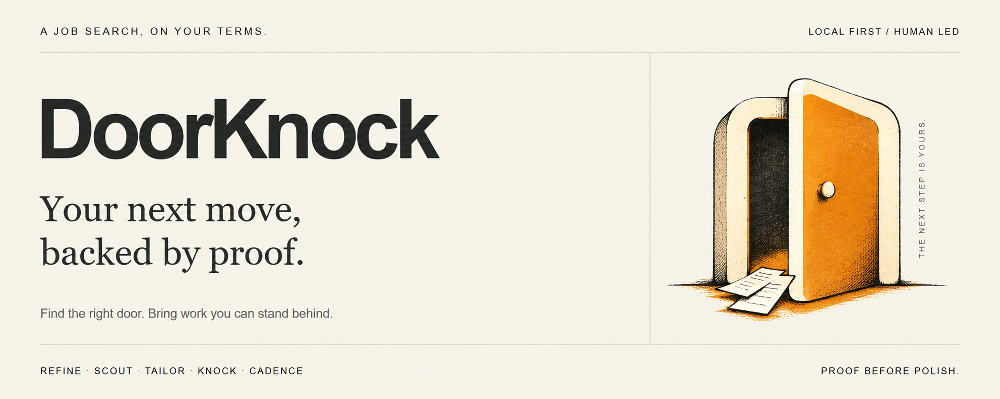
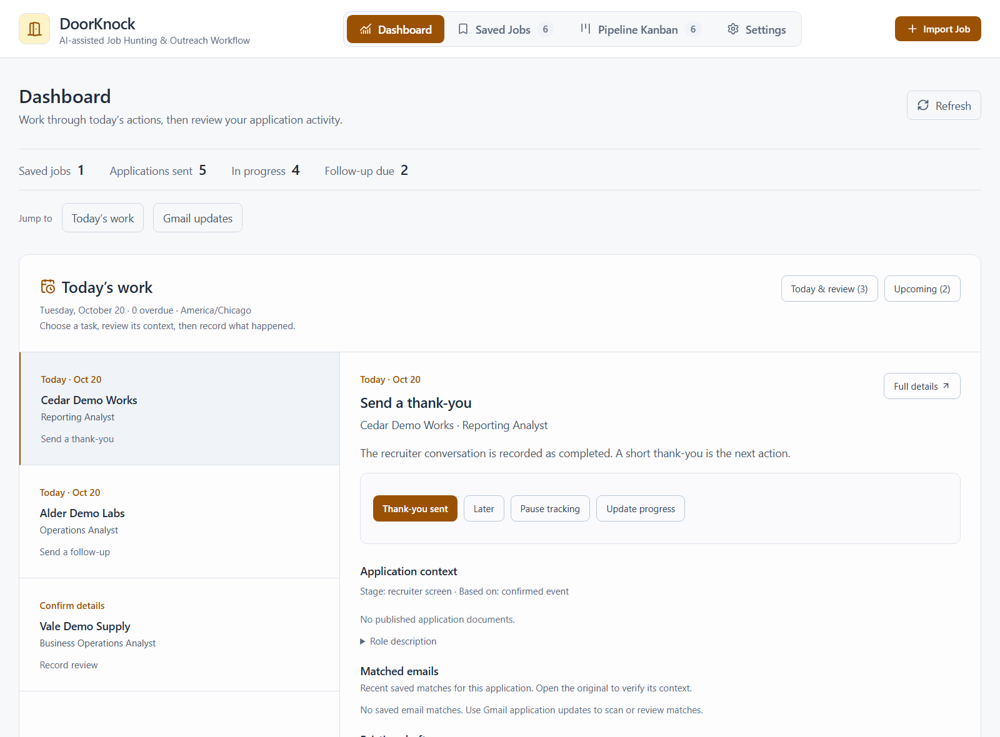
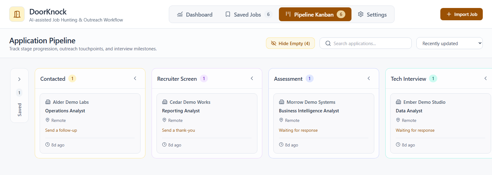

<p align="center">
  
</p>

# DoorKnock

DoorKnock is a local-first workspace for job applications. Compare a role with your experience, prepare a resume and outreach draft, then keep track of replies and follow-ups.

Your evidence, documents, contacts, and application history stay together, whether you work in the app or with an agent.

[See the workflow](#from-evidence-to-a-conversation) · [Run it locally](#run-it-locally) · [Read the philosophy](docs/philosophy.md) · [中文理念](docs/philosophy-ZH.md)



*The actual interface, in Calm light mode. All companies, roles, and application records shown here are synthetic demonstration data.*

## Why knock?

A job application is an exchange of value. Start with what the role needs, then show the work that makes you a credible candidate.

Tailoring should describe what you actually did. Coursework and portfolio work must not become employment history, and unsupported requirements stay visible as gaps.

AI helps with analysis and drafts. You review the claims and decide what to send.

## From evidence to a conversation

The name comes from 叩門: take the initiative and knock. The workflow has five stages:

| Practice | The question it answers | What you work with |
| --- | --- | --- |
| **淬金 · Refine** | What can I actually back up? | A reusable evidence bank of experience, projects, skills, and sources. |
| **辨門 · Scout** | What does this role need, and who knows the work? | Job analysis, company context, and research on recruiters, managers, and peers. |
| **鑄磚 · Tailor** | Which proof belongs in this application? | Resumes and cover letters compiled with Typst, with separate version histories. |
| **叩門 · Knock** | How do I start a useful conversation? | Short outreach drafts grounded in the role and the person receiving them. |
| **候應 · Cadence** | What is the next sensible move? | Confirmed events, follow-up dates, interview preparation, and room to step away. |

Use the part you need. Reviewing a role can end with a decision to pass.

### Open it and know what to do today

The Dashboard puts dated actions in order and keeps the selected application's history, documents, and drafts close at hand. Record what happened, save it, and move to the next task. Postpone a reminder or pause tracking when it makes sense. Silence alone never closes an application.

The pipeline gives you the wider view, from saved roles through interviews and outcomes.



*The same synthetic records in the pipeline. Application stage and next action are tracked separately.*

### Make a case you can defend

Import a job URL or paste its description, review the extracted text, and compare it with your evidence. The analysis distinguishes direct experience, transferable work, and gaps. A match score is a prompt for judgment; it is not an interview probability.

Tailor a resume or a cover letter from that evidence. Keyword alignment guides rewrites of relevant source statements using supported terms from the job description, preserving the original work, scope, and results. The evidence bank keeps its original wording. Claim review checks the rewritten claims before publication. Typst handles the layout; published versions stay available when you revise. PDFs use selectable text and standard sections. Content and visual checks are still part of the work.

### Work in the app, or with your agent

The web app handles job intake, analysis, document generation, outreach drafts, and application tracking. Choose Gemini or Codex in Settings for its AI features.

For closer collaboration, the repository includes focused [agent skills](.agents/skills/). Ask your agent to review a role, refine an evidence claim, draft an introduction, or practice one interview answer at a time. Company and contact research can use separately configured MCP connections; those services are optional, not included accounts.

The two paths share the same private candidate workspace. Researching a person, saving a draft, sending it, and recording a reply are separate decisions.

## Your evidence stays yours

DoorKnock separates the reusable system from the person using it:

```text
backend/ + frontend/ + .agents/skills/    The shared tools
workspace/                              Your evidence and documents
data/jobs.db                            Your application records
```

`workspace/`, `data/`, and `.env` are excluded from Git. Candidate identity and accomplishments are loaded from private files rather than built into the application.

AI features send relevant job and candidate context to the provider you select. Gemini and Codex/ChatGPT have their own account requirements and data-handling terms. Review those before using sensitive information. Optional connected services have their own permissions too.

DoorKnock prepares documents and outreach drafts. You submit applications and send messages. Progress records follow confirmed events; copying a draft or preparing for an interview does not count as completing either action.

## Run it locally

DoorKnock is an early project with a developer-oriented setup. You will need **Python 3.11+**, [uv](https://docs.astral.sh/uv/), and **Node.js 20.19+ or 22.12+** with npm for the [Vite 8 frontend](https://vite.dev/guide/#scaffolding-your-first-vite-project). AI features also need a Gemini API key or an authenticated Codex CLI account. See [prerequisites](docs/prerequisites.md) for supporting services and optional MCP setup.

From the repository root:

```sh
uv sync --extra dev
```

Copy `.env.example` to `.env`. For Gemini, set `GEMINI_API_KEY`. For Codex, install and sign in to Codex CLI, then select Codex in the app's Settings.

Build the interface and start the app:

```sh
cd frontend
npm ci
npm run build
cd ..
uv run uvicorn app.main:app --app-dir backend --reload --port 8000
```

Open [localhost:8000](http://localhost:8000).

### Add your candidate workspace

Before using analysis and tailoring, create these private files:

```text
workspace/profile.yaml                         Identity, contact details, links
workspace/master_resume/master_evidence.yaml    Experience, projects, skills, claims
```

Start with the [workspace setup examples](docs/code-data-separation.md#3-how-to-set-up-a-new-candidate-workspace). Workspace setup is manual; there is no first-run wizard.

The `doorknock-*` skills are discovered by compatible agents from `.agents/skills/`. [Sepia](https://github.com/Nanako0129/sepia) is an optional third-party writing skill, installed separately; see the [installation notes](docs/prerequisites.md#2-optional-sepia-agent-skill).

## Working on DoorKnock

The stack is **FastAPI · SQLite · React · TypeScript · Tailwind · Typst**. Keep contributions candidate-agnostic and use fictional fixtures. Read [AGENTS.md](AGENTS.md) before changing the system or handling application records.

Run the full backend suite, including the candidate-data leak guard:

```sh
uv run pytest tests
```

For frontend development, run `npm run dev` from `frontend/` alongside the backend. Vite proxies `/api` to port 8000. Run `npm run build` to check types and produce the served frontend.

<details>
<summary>Appearance, dates, and document settings</summary>

In **Settings → Appearance**, choose Classic (the default) or Calm. Calm offers Light, Dark, and Follow system. Appearance is saved in the current browser; without browser storage it lasts for the session. Switching styles preserves the current page and in-progress inputs. The screenshots above use Calm Light.

Both styles use a 125% root font size. Use shared `ui-*` color roles and `rem` dimensions when extending the interface. Theme roles live in `frontend/tailwind.config.js` and `frontend/src/appearance.css`; `appearance-init.js` applies preferences before React loads.

Choose a time zone in **Settings → Time zone**, or use the device time zone and save. The default is `America/Chicago`; the setting is stored in the private `workspace/time-settings.json`. Calendar dates keep their recorded day. New timestamps include an offset; older timestamps without one are marked “time zone not recorded” rather than assigned a guessed offset. Published documents retain their dates and dimensions.

Resume v001 permits multiple pages. Later resume versions follow the saved one-page preference. Cover letters fit on one page. Resumes and cover letters are published and versioned independently. See the [document workflow](workflow.md#5-application-documents-agent-conversation-and-web-ui) for checks and version paths.

</details>

## Read further

- [Philosophy](docs/philosophy.md) · [中文原文](docs/philosophy-ZH.md)
- [Workflow manual](workflow.md): app and agent paths, documents, Gmail review, and application progress
- [Follow-up policy](docs/cadence.md): timing, confirmed events, and when to pause
- [Prerequisites and optional services](docs/prerequisites.md)
- [System and candidate-data separation](docs/code-data-separation.md)

MIT licensed. See [LICENSE](LICENSE).
